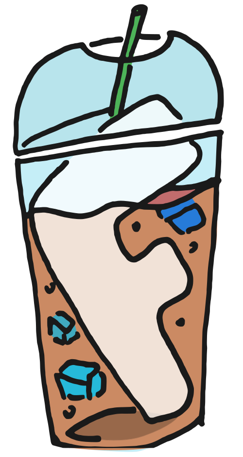

  

# Freppuccino

Freppuccino makes implicit geometry available natively in Rhino for everyone.

# What is implicit geometry?

Implicit geometry is a geometry type that is made parametrically using functions (don't worry, you don't need to know the functions!).

# Authors

- Ben Howes
- Callum Sykes
- Dan Cascaval
- Danniel Cho Valadao
- Luke Gehron
- Mathieu Huard
- Sam Potter
- Sergey Pigach